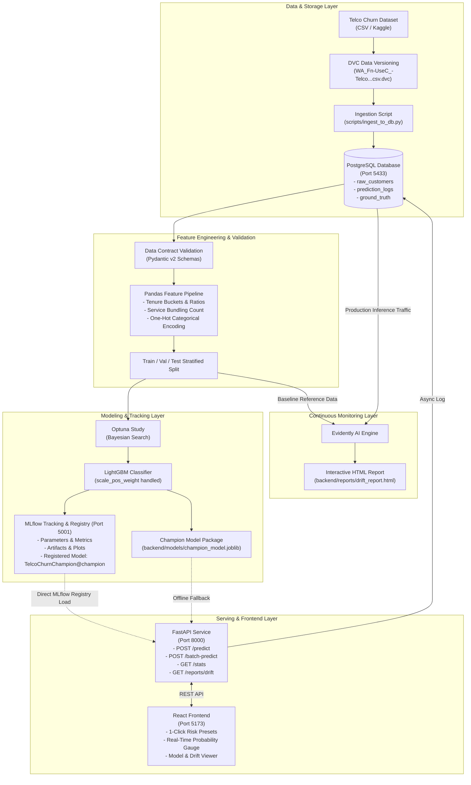

# Telco Customer Churn

[](https://fastapi.tiangolo.com/)
[](https://react.dev/)
[](https://lightgbm.readthedocs.io/)
[](https://mlflow.org/)
[](https://dvc.org/)
[](https://www.evidentlyai.com/)
[](https://www.docker.com/)
[](https://www.postgresql.org/)
[](https://www.python.org/)

An end-to-end, production-grade Machine Learning and MLOps system that predicts customer churn using the **[Kaggle Telco Customer Churn Dataset](https://www.kaggle.com/datasets/blastchar/telco-customer-churn)**.

This repository demonstrates industry best practices for the entire ML lifecycle:
- **Relational Data Management** with PostgreSQL.
- **Data Versioning & Pipeline DAG** with DVC (`dvc.yaml`).
- **Data Validation & Type Contracts** with Pydantic v2.
- **Modular Feature Engineering** with Pandas (`TelcoFeaturePipeline`).
- **Hyperparameter Optimization & Training** with Optuna and LightGBM.
- **Experiment Tracking & Model Registry** with MLflow (`TelcoChurnChampion@champion`).
- **Continuous Data Drift & Data Quality Monitoring** with Evidently AI.
- **High-Performance REST Serving** with FastAPI (dynamic MLflow model loading).
- **Interactive UI Dashboard** with React (Vite) & TreeSHAP explainability.
- **Multi-Service Infrastructure Orchestration** with Docker Compose.

---

## 📑 Table of Contents
1. [Architecture & Workflow](#-architecture--workflow)
2. [Tech Stack Deep Dive](#-tech-stack-deep-dive)
3. [Project Folder Structure](#-project-folder-structure)
4. [Prerequisites & Requirements](#-prerequisites--requirements)
5. [Quickstart Step-by-Step Guide](#-quickstart-step-by-step-guide)
   - [1. Start Infrastructure via Docker Compose](#step-1-start-infrastructure-services-docker)
   - [2. Setup Backend Virtual Environment](#step-2-setup-backend-virtual-environment)
   - [3. Download & Ingest Dataset into PostgreSQL](#step-3-download--ingest-dataset-into-postgresql)
   - [4. Hyperparameter Tuning with Optuna](#step-4-hyperparameter-tuning-with-optuna-optional)
   - [5. Train LightGBM & Register with MLflow](#step-5-train-lightgbm--register-with-mlflow)
   - [6. Reproducible Pipelines with DVC](#step-6-reproducible-pipelines-with-dvc)
   - [7. Start FastAPI Serving API](#step-7-start-fastapi-backend)
   - [8. Launch React Frontend Dashboard](#step-8-launch-react-frontend-dashboard)
   - [9. Continuous Monitoring & Drift Detection with Evidently AI](#step-9-continuous-monitoring--drift-detection-with-evidently-ai)
6. [API Reference & Example Payloads](#-api-reference)
7. [Automated Testing](#-automated-testing)
8. [MLOps Concepts & What You Learn](#-mlops-concepts--key-takeaways)

---

## 🏛 Architecture & Workflow



---

## 🛠 Tech Stack Deep Dive

| Tool | Purpose in this Project | Why It's Used |
| :--- | :--- | :--- |
| **DVC** | Data Version Control & Pipelines | Tracks large CSV datasets without bloating Git. Orchestrates reproducible `tune` $\rightarrow$ `train` $\rightarrow$ `drift` pipeline stages via `dvc.yaml` with smart caching. |
| **PostgreSQL** | Relational Database | Stores raw customer profiles, streaming inference logs, and actual ground-truth feedback. Also serves as backend store for MLflow. |
| **Pandas** | Feature Engineering Pipeline | Clean, reproducible tabular transformations: missing data imputation, tenure duration features, financial ratios, and service bundling metrics. |
| **Pydantic v2** | Data Contracts & Validation | Guarantees schema enforcement on raw data and API payloads, automatically catching type errors and missing attributes at ingestion and runtime. |
| **LightGBM** | Machine Learning Classifier | State-of-the-art gradient boosted decision tree algorithm optimized for tabular data; naturally handles categorical indicators and class imbalance. |
| **Optuna** | Hyperparameter Tuning | Automated Bayesian hyperparameter search (pruning unpromising trials, optimizing learning rate, tree depth, and regularization). |
| **MLflow** | Experiment Tracking & Registry | Logs metrics (ROC-AUC, PR-AUC, F1), hyperparameters, model artifacts, and registers champion models (`TelcoChurnChampion@champion`) for inference. |
| **Evidently AI** | Drift & Quality Monitoring | Detects feature distribution shifts (Data Drift) and prediction shifts (Target Drift) using statistical tests (Wasserstein distance, KS test). |
| **FastAPI** | Model Serving & REST API | Ultra-low latency asynchronous API framework that loads models directly from MLflow Model Registry with automatic Swagger documentation. |
| **React (Vite)** | Frontend UI Dashboard | Modern interactive web UI to test single customer profiles with 1-click risk presets, view probability gauges, inspect feature weights, and check drift reports. |
| **Docker Compose** | Infrastructure Orchestration | Spins up PostgreSQL (port 5433) and the MLflow server (port 5001) in isolated, reproducible containers. |

---

## 📂 Project Folder Structure

```
Churnz/
├── dvc.yaml                        # DVC pipeline DAG (tune -> train -> drift)
├── dvc.lock                        # Locked dependency hashes and cached stage outputs
├── .dvc/                           # DVC internal configuration and local cache
├── docker-compose.yml              # Docker services for PostgreSQL and MLflow
├── .gitignore                      # Git ignore patterns (with DVC pointer tracking)
├── README.md                       # Complete documentation & tutorial
│
├── backend/                        # Backend service & ML pipelines
│   ├── .env.example                # Environment variable configuration template
│   ├── requirements.txt            # Python dependencies
│   ├── data/
│   │   ├── raw/                    # Raw Telco Churn CSV tracked via DVC (.dvc)
│   │   │   └── WA_Fn-UseC_-Telco-Customer-Churn.csv.dvc
│   │   └── processed/              # Processed reference dataset for Evidently drift detection
│   ├── models/                     # Serialized champion model artifacts (.joblib)
│   │   ├── best_hyperparams.json   # Optimal Bayesian parameters from Optuna
│   │   └── champion_model.joblib   # Champion model package (model + pipeline + metrics)
│   ├── reports/                    # Generated Evidently AI HTML drift reports
│   ├── mlartifacts/                # MLflow tracked artifacts
│   │
│   ├── src/                        # Core application modules
│   │   ├── __init__.py
│   │   ├── config.py               # Pydantic BaseSettings environment config
│   │   ├── schemas.py              # Pydantic v2 request/response and customer data contracts
│   │   ├── database.py             # SQLAlchemy models & connection pool for PostgreSQL
│   │   ├── pipeline.py             # Pandas TelcoFeaturePipeline (fit & transform)
│   │   ├── train.py                # LightGBM classifier training + MLflow tracking
│   │   ├── tune.py                 # Optuna hyperparameter optimization study
│   │   ├── monitoring.py           # Evidently AI drift & data quality report generator
│   │   └── main.py                 # FastAPI application with CORS and REST routes
│   │
│   ├── scripts/                    # CLI execution scripts
│   │   ├── download_data.py        # Automated Telco dataset downloader
│   │   ├── init_db.py              # Initialize PostgreSQL tables
│   │   ├── ingest_to_db.py         # Ingest raw CSV data into PostgreSQL
│   │   ├── run_training.py         # Train champion LightGBM model
│   │   ├── run_tuning.py           # Run Optuna hyperparameter tuning study
│   │   └── run_drift_report.py     # Generate interactive Evidently AI drift dashboard
│   │
│   └── tests/                      # Automated test suite
│       ├── __init__.py
│       ├── test_schemas.py         # Pydantic schema validation tests
│       ├── test_pipeline.py        # Pandas feature transformation tests
│       └── test_api.py             # FastAPI endpoint and inference tests
│
└── frontend/                       # Interactive React dashboard (Vite)
    ├── package.json
    ├── vite.config.js
    ├── index.html
    └── src/
        ├── App.jsx                 # Interactive churn predictor & monitoring dashboard
        ├── App.css                 # Clean modern styling & risk meter components
        └── main.jsx
```

---

## 💻 Prerequisites & Requirements

- **Operating System**: Windows, macOS, or Linux.
- **Python**: `Python 3.12` (recommended for full prebuilt wheel compatibility).
- **Node.js**: `Node.js >= 18` and `npm >= 9`.
- **Docker**: `Docker Desktop` or Docker Engine running with Docker Compose.

---

## ⚡ Quickstart Step-by-Step Guide

### Step 1: Start Infrastructure Services (Docker)

To run PostgreSQL and MLflow in isolated containers:

```powershell
# From the project root (Churnz/):
docker compose up -d
```

> [!NOTE]
> - **PostgreSQL** is mapped to port **5433** (to prevent collision with any default PostgreSQL running on 5432).
> - **MLflow UI** is accessible at: **[http://localhost:5001](http://localhost:5001)**.
> - *Tip*: If you prefer running without Docker initially, the backend automatically falls back to local SQLite (`sqlite:///backend/mlflow.db`) and standalone mode seamlessly!

---

### Step 2: Setup Backend Virtual Environment

Navigate to the `backend/` directory and create a virtual environment:

```powershell
cd backend

# Create virtual environment with Python 3.12
py -3.12 -m venv venv

# Activate the virtual environment
# On Windows PowerShell:
.\venv\Scripts\Activate.ps1
# On macOS / Linux:
# source venv/bin/activate

# Install all backend requirements
pip install -r requirements.txt
```

---

### Step 3: Download & Ingest Dataset into PostgreSQL

The dataset is the **[Telco Customer Churn dataset](https://www.kaggle.com/datasets/blastchar/telco-customer-churn)**.

You can download it automatically with the helper script:

```powershell
# From backend/ with venv activated:
python scripts/download_data.py
```
*(The file `WA_Fn-UseC_-Telco-Customer-Churn.csv` will be saved to `backend/data/raw/`)*

Next, initialize the tables and ingest the raw customer data into PostgreSQL:

```powershell
# Create tables in PostgreSQL (raw_customers, prediction_logs, ground_truth_feedback)
python scripts/init_db.py

# Ingest all 7,043 customer rows into PostgreSQL
python scripts/ingest_to_db.py
```

---

### Step 4: Hyperparameter Tuning with Optuna (Optional)

Run an Optuna Bayesian search over LightGBM hyperparameters (learning rate, tree depth, number of leaves, regularization, etc.):

```powershell
python scripts/run_tuning.py
```
This runs 15 cross-validated trials and outputs the optimal parameter configuration.

---

### Step 5: Train LightGBM & Register with MLflow

Train the champion LightGBM classifier with class imbalance handling (`scale_pos_weight`) and tuned Optuna hyperparameters:

```powershell
python scripts/run_training.py
```

**What this does:**
1. Loads the raw dataset and applies `TelcoFeaturePipeline` (tenure binning, service bundling count, financial ratios).
2. Stratifies train/test splits (80/20) without data leakage.
3. Automatically ingests tuned hyperparameters from `backend/models/best_hyperparams.json`.
4. Trains LightGBM with early stopping and evaluates:
   - **Recall: `79.14%`** (identifies ~4 out of 5 at-risk churners in advance)
   - **ROC-AUC: `0.8402`** (Validation AUC: `0.8492`)
   - **PR-AUC: `0.6342`** | **F1 Score: `0.6218`**
5. Logs parameters and metrics to the MLflow **Runs** tab.
6. **Publishes & registers** the model to the MLflow **Models** tab under **`TelcoChurnChampion`** with the **`@champion`** alias.
7. Serializes the champion model artifact bundle to `backend/models/champion_model.joblib`.
8. Exports the training baseline distribution to `backend/data/processed/reference_data.csv` for drift detection.

Open your browser to inspect the registered model in the **MLflow UI**: **[http://localhost:5001/#/models](http://localhost:5001/#/models)**.

---

### Step 6: Reproducible Pipelines with DVC

The entire data preparation, tuning, training, and drift monitoring workflow is codified as a Directed Acyclic Graph (DAG) in [`dvc.yaml`](file:///c:/Users/sandi/Documents/AI/Churnz/dvc.yaml).

```powershell
# In the project root (Churnz/):

# 1. Visualize the complete pipeline DAG in your terminal
dvc dag

# 2. Check if any code, dependencies, or datasets have changed
dvc status

# 3. Reproduce the pipeline with smart caching
dvc repro
```

**Smart Caching in Action:**
* If neither data nor code has changed, DVC skips all stages:
  ```
  Stage 'tune' didn't change, skipping
  Stage 'train' didn't change, skipping
  Stage 'drift' didn't change, skipping
  Data and pipelines are up to date.
  ```
* If you only edit `backend/src/monitoring.py`, DVC automatically skips `tune` and `train` and only re-runs the `drift` stage.

---

### Step 7: Start FastAPI Backend

Launch the FastAPI serving server:

```powershell
# From backend/ with venv activated:
uvicorn src.main:app --reload --host 0.0.0.0 --port 8000
```

- **Dynamic Model Loading**: FastAPI automatically checks MLflow Model Registry for **`TelcoChurnChampion@champion`** on startup, falling back gracefully to the local disk artifact if MLflow is offline.
- **API Base URL**: `http://localhost:8000`
- **Interactive Swagger Docs**: **[http://localhost:8000/docs](http://localhost:8000/docs)**
- **Health Check & Model Version**: `http://localhost:8000/health`
- **Model Stats & Metrics**: `http://localhost:8000/stats`

---

### Step 8: Launch React Frontend Dashboard

Open a new terminal window, navigate to `frontend/`, and launch the development server:

```powershell
cd frontend
npm run dev
```

Open your browser to: **[http://localhost:5173](http://localhost:5173)**.

#### Frontend Capabilities:
- **1-Click Presets**: Test "High Risk Customer" (Fiber optic, Month-to-month, high spend, low tenure) vs "Loyal Customer" with one click.
- **Dynamic Probability Gauge**: Real-time animated meter showing churn risk tier (Low, Medium, High).
- **Explainable AI Indicators**: Native LightGBM TreeSHAP breakdown of why the customer was flagged.
- **Model Insights Tab**: Live charts of ROC-AUC, PR-AUC, and LightGBM top 10 feature importances.
- **Inference History**: View recent prediction events recorded in PostgreSQL.

---

### Step 9: Continuous Monitoring & Drift Detection with Evidently AI

As your model serves predictions in production, customer behavior changes (inflation shifts charges, contract term distributions shift). Evidently AI monitors this to prevent model decay.

To simulate production inference traffic and generate a drift report:

```powershell
# From backend/ with venv activated:
python scripts/run_drift_report.py
```

- Interactive HTML Report saved to: `backend/reports/drift_report.html`.
- View it directly in your browser or through the API: **[http://localhost:8000/reports/drift](http://localhost:8000/reports/drift)**.

The report includes:
- **Data Drift Summary**: Statistical tests (KS test, Wasserstein distance) comparing production features against training baseline.
- **Data Quality & Summary**: Missing values, categorical distribution changes, numerical quantile shifts.

---

## 📡 API Reference

### 1. Healthcheck
`GET /health`
```json
{
  "status": "healthy",
  "model_loaded": true,
  "model_path": "models/champion_model.joblib"
}
```

### 2. Predict Customer Churn
`POST /predict`

**Request Body:**
```json
{
  "customer_id": "CUST-7742",
  "gender": "Female",
  "SeniorCitizen": 0,
  "Partner": "No",
  "Dependents": "No",
  "tenure": 3,
  "PhoneService": "Yes",
  "MultipleLines": "No",
  "InternetService": "Fiber optic",
  "OnlineSecurity": "No",
  "OnlineBackup": "No",
  "DeviceProtection": "No",
  "TechSupport": "No",
  "StreamingTV": "Yes",
  "StreamingMovies": "Yes",
  "Contract": "Month-to-month",
  "PaperlessBilling": "Yes",
  "PaymentMethod": "Electronic check",
  "MonthlyCharges": 94.85,
  "TotalCharges": 284.55
}
```

**Response Body:**
```json
{
  "customer_id": "CUST-7742",
  "churn_prediction": 1,
  "churn_probability": 0.8124,
  "risk_level": "High",
  "explanation": [
    "Month-to-month contract (3x higher churn rate)",
    "Tenure less than 1 year (new subscriber vulnerability)",
    "Fiber optic subscription with high monthly fees",
    "Lack of dedicated Tech Support add-on",
    "Electronic check payment (statistically correlated with churn)"
  ]
}
```

### 3. Model Statistics
`GET /stats`
Returns the champion model's evaluation metrics (ROC-AUC, PR-AUC, Accuracy, F1) and top feature importances.

### 4. Interactive Drift Report
`GET /reports/drift`
Serves the Evidently AI HTML dashboard directly in your browser.

---

## 🧪 Automated Testing

Unit and integration tests are powered by `pytest`:

```powershell
# From backend/ directory:
.\venv\Scripts\pytest tests -v
```

**Test Coverage:**
- `test_schemas.py`: Validates Pydantic v2 data contracts, handles blank/space `TotalCharges`, and asserts error handling for illegal enum inputs.
- `test_pipeline.py`: Verifies Pandas feature engineering, column generation, and absence of data leakage between fit and transform.
- `test_api.py`: Validates `/health`, `/predict`, and payload responses using FastAPI `TestClient`.

---

## 🧠 MLOps Concepts & Key Takeaways

1. **Data Contracts (Pydantic v2)**: Real-world data is dirty. Schemas enforce strict typing and boundary validation before dirty data can reach training or inference pipelines.
2. **Handling Class Imbalance**: In telecom churn (~26.5% positive churn rate), optimizing solely for accuracy results in deceptive models. Using dynamic `scale_pos_weight` and prioritizing **Recall (79.14%)**, **ROC-AUC (0.8402)**, and **PR-AUC (0.6342)** ensures high-risk churners are caught.
3. **Data Versioning & Pipelines (DVC)**: Git tracks small code files, while DVC tracks heavy CSVs using lightweight pointer files (`.dvc`). The `dvc.yaml` pipeline DAG prevents redundant re-computation via smart dependency caching.
4. **Reproducibility with Pipelines**: The `TelcoFeaturePipeline` encapsulates all feature cleaning, encoding, and engineering so that identical transformations occur during both batch training and real-time inference without training-serving skew.
5. **Experiment Tracking & Model Registry**: MLflow records all trial parameters and metrics across runs, while the Model Registry (`TelcoChurnChampion@champion`) decouples model release management from application code deployments.
6. **Data Drift vs. Concept Drift**: Even with a high-performing model, performance decays if production customer behavior shifts. Evidently AI provides proactive visibility by testing for statistical distribution divergence (KS-test, Wasserstein distance).
